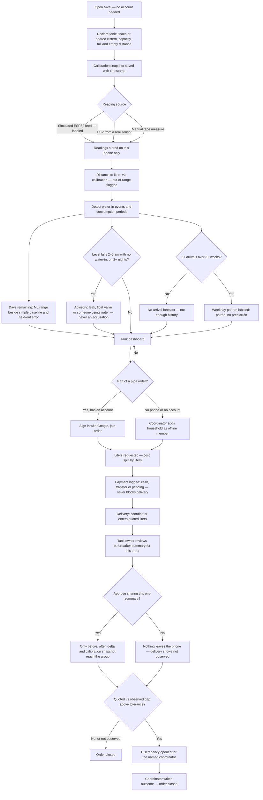
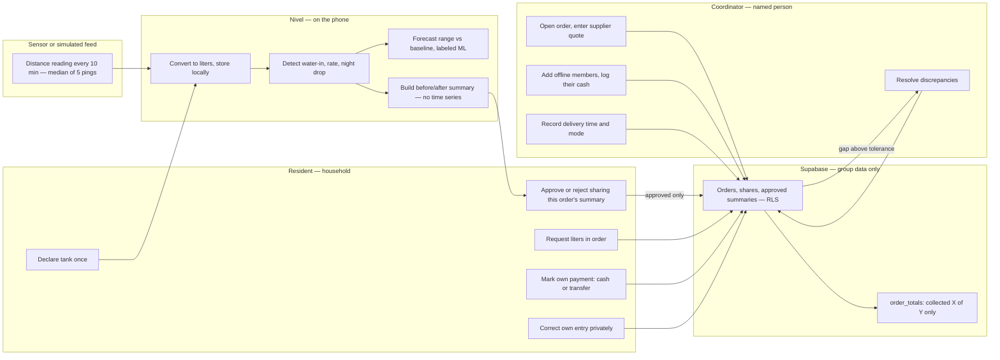

# PACKET — Nivel · Week 11 (Dreaming of Plenitude)

**Builder:** Rafael Pieck · **Role:** TECHNOLOGIST · **Vacuum:** Household water tools — *Pipa entre vecinos*
**Repo:** `rafapieck/nivel` · **Stack floor:** 🐉 Dragon — IoT/sensing + ML + marketplace logic
**Blueprint slice:** calibrated tank log + advisory forecast (conditions 3, 6). The pipa order is built thin, as the interface to Rodrigo's (USER) shared-order slice — see §10.

---

## 1. The problem, in my words

Every smart-water product in the world measures the pipe. Millions of Mexican homes don't get water from the pipe: they get it a couple of times a week by tandeo, store it in a tinaco or a shared cistern, and buy a pipa when it runs out. Under tandeo the meter spins on air, so the house's real meter is the tank. Families can't see when water came in, how much, how long it will last, or whether it's leaking at night. When neighbors split a pipa, the only record is a WhatsApp thread and someone's memory of who paid, and that is exactly where disputes start.

The tools that do exist were built to see the household **for whoever bills or cuts it**. Nivel sees it **for the family**, and shares only what the family approves, one order at a time.

## 2. Exact user

**Primary:** the person who coordinates water for a small shared building or vecindad (4–8 households, one shared cistern or individual tinacos, pipa 2–4 times a month). Has their own tank. Android phone, fluent in WhatsApp, unreliable home Wi-Fi, often collects cash. Typically 45–65, reads carefully, and quits without a word when an app asks for too much up front.

**Secondary:** each household in that group, who wants to know "how many days do I have" without climbing up to open the tinaco lid. **At least one of them has no smartphone or no Google account**, and the product has to work for that household too (condition 2).

## 3. Success definition

> **Before the module closes**, at the live URL:
> 1. **Tank, no account:** a household declares its tank in **≤ 2 minutes** and loads ≥ 72 h of readings (simulated feed, sensor CSV, or manual tape measure). It then sees **water-in events, liters in, days remaining as a range next to the simple baseline and the held-out error of both, and a night-drop advisory**. Readings stay on the phone, with no account.
> 2. **Pipa order, end to end:** a group of ≥ 3 households, **including one offline member added by the coordinator**, runs one order: liters requested, cost split by liters, payments logged (cash / transfer / pending), and **quoted / observed / estimated** liters recorded separately. The **named coordinator** resolves one discrepancy.
> 3. **Labels:** every simulated feed and every ML output is labeled as such on screen.

## 4. Mockup (image-generated)


*Prompt used to generate it:*
> Mobile app screen mockup, clean flat design, Spanish UI, for an app called "Nivel" that reads a rooftop water tank (tinaco) in Mexico. Top: a yellow banner "FEED SIMULADO". Center: a large tank illustration filled to 62% with the text "680 L de 1,100 L". Below: a card "Te alcanza para unos 3–4 días" with a small gray tag "Estimación (ML) · Base simple: 3.2 días · error ±0.4 d". A timeline strip of the last 72 hours showing a sharp rise labeled "Entró agua · mar 2:10–4:40 pm · +420 L". A soft orange card "Bajada nocturna 2 noches seguidas — puede ser una fuga, el flotador o alguien usando agua". Bottom nav with four tabs: Tinaco, Historial, Pipa, Ajustes. Calm blue and white palette, large readable text, Android phone frame.

## 5. Flow

### 5.1 Feature flowchart



### 5.2 Swimlane — who does what



## 6. Benchmark

- **The best existing solution on Earth for this is** Flume (US): a clip-on sensor the homeowner straps to their own meter and buys directly, with leak alerts within hours. On the utility side, the reference is Kamstrup's smart metering, which uses minimum-night-flow leak logic.
- **Mine differs/localizes by** measuring the tank instead of the meter (under tandeo the meter spins on air); working offline, with the phone as the gateway instead of home Wi-Fi; keeping raw data with the household instead of the utility; and adding the one thing no meter does, a shared pipa record between neighbors that includes neighbors with no smartphone.

## 7. Long view (3 years)

If this slice works, Nivel becomes the record a household and its neighbors own for every liter that reaches them. A few-hundred-peso sensor on the tank, syncing through the phone, knows when water came in, how much, and where it went. With enough groups opting in, neighbors could negotiate pipas against observed liters, not quoted ones. Organized residents could hand an independently verified summary to an auditor, but only if each family chooses to, and only after a verified operating partner and an agreed process exist (condition 4). Revenue comes from the device, never from the data, and that wall stays load-bearing.

## 8. Scope cut — NOT building this week

**Next ship (cut for the one-day deadline):**
- **72-hour field test on a real tinaco**, with the result in `docs/FIELD_TEST.md`. This ship runs on simulated, CSV and manual data; real-data screens still get the green "DATOS REALES" banner if a CSV from a real tank is loaded.
- **Offline mode** (Serwist service worker, airplane-mode test). The page needs a connection to load; readings are still stored only on the phone, and the tank module still needs no account.
- **Edit history for payment entries** (`order_share_history`). Members can still correct their own entries privately (condition 2); the edit just overwrites the value.

**Out of scope entirely:**
- ESP32 firmware or Bluetooth sync. CSV import in the firmware's format (`timestamp,distance_cm`) is the bridge; firmware is the next ship.
- Arrival-time prediction without history (condition 6)
- Non-cylindrical tank geometry (horizontal or conical tanks). The calibration assumes a vertical cylinder, and the screen says so.
- Supplier directory, ratings or booking; municipal integration (condition 4)
- Holding, escrowing or withholding money. Nivel **logs** money and never moves it (condition 4).
- Reputation scores, public debtor lists, reminders that name who owes, any automatic denial (condition 2)
- Automatic leak or fraud accusations (condition 3)
- LLM-generated text. Template sentences only: free stack, no hallucinated numbers. (This is a deliberate change from the brief: false precision is worse than plain wording.)
- Push notifications, native app, multi-tank homes, cloud backup of raw readings

## 9. Blueprint conditions → how Nivel honors them

| # | Condition | Implementation |
|---|-----------|----------------|
| 1 | Residents control sharing | Raw readings live in IndexedDB on the phone; the tank module needs no account. Sharing is **per order, never a standing permission**. The approved summary contains only before L, after L, delta L, a calibration snapshot and a concurrent-use note, **never the time series** (strict Zod schema). No supplier, landlord or authority endpoints exist. |
| 2 | **Shadow clause** | No scores, no rankings, no "who owes" list. A member's payment status is readable only by that member and the coordinator (RLS); everyone else sees `order_totals` ("collected $X of $Y"), through a function that returns no per-person rows. **Offline members:** the coordinator adds a household with no phone or account and logs its cash, so cash is a first-class method. **Payment status never gates delivery or membership:** there is no code path from "pending" to exclusion. Members correct their own entries privately. |
| 3 | Quoted / observed / estimated separate | Three columns on every delivery. **Quoted** = supplier's number, entered by the coordinator. **Observed** = sum of approved tank deltas, with "N of M tanks reported", or "no observado". **Estimated** = observed + consumption rate × fill duration (corrects for water used during the fill), tagged ML. Each delta stores its calibration snapshot, timestamp and concurrent-use note. UI copy: "Las lecturas del tinaco no son prueba de volumen." A gap only opens a discrepancy for a human; nothing is auto-accused. |
| 4 | Named person handles discrepancies | Each group has exactly one named coordinator, and discrepancies route only to them. The raiser can see the status and the resolution note, and a discrepancy can't be deleted. No supplier directory, no payments held. |
| 5 | Measure total cost | The `/costo` page is a worksheet for sensor, installation, support, and coordinator minutes per order, compared against the current WhatsApp workflow. Inputs are editable, nothing is pre-filled as a result, and no ROI is claimed. Coordinator minutes per order are logged on real orders, which answers USER's dissent: sensing must reduce coordination work. |
| 6 | Label simulated feeds/ML; baseline | A yellow "FEED SIMULADO" banner and a green "DATOS REALES" banner. Every ML number is tagged "Estimación (ML)" next to the baseline value and the held-out error of both. No arrival forecast without ≥ 6 arrivals over ≥ 3 weeks. |

## 10. Slice and interfaces with the team

| Slice (Blueprint) | Owner | What Nivel does with it |
|---|---|---|
| Calibrated tank log + advisory forecast | **Rafael / TECHNOLOGIST** | **Built in full** — this ship's core. |
| Shared-order and expense flow | Rodrigo / USER | Built **thin**: one order, proportional split, payment log, offline members. The schema (`orders`, `order_shares`) is the contract Rodrigo's flow can replace or extend. |
| Baseline, cost worksheet, pricing gate | MONEY | `/costo` worksheet with empty inputs; numbers come from MONEY. |
| Coordinator + delivery map + exceptions | Nicolás / OPERATOR | Coordinator role and discrepancy routing; the real coordinator comes from his recruitment. |
| Challenge confirmation, access, data control | Fátima / ADVERSARY | Test cases 10–14 are written for her to break. |

## 11. Architecture

```
Phone (Next.js web app)
 ├─ Tank module (local only, no auth)
 │   ├─ Feed: simulator | CSV import | manual entry
 │   ├─ IndexedDB: tanks, calibrations, readings  (navigator.storage.persist())
 │   ├─ Local export: CSV backup the owner downloads by hand
 │   └─ Analysis (TypeScript, in browser): calibration, water-in, rate, forecast, night drop
 └─ Pipa module (online)
     ├─ Supabase Auth (Google) — coordinator and members with accounts
     └─ Supabase Postgres + RLS: groups, members (incl. offline), orders, shares,
        deliveries, tank_summaries, discrepancies · RPC order_totals()
```

### Stack

| Layer | Choice | Why |
|-------|--------|-----|
| Frontend | Next.js (App Router) + TypeScript + Tailwind | Same as previous ships; deploys free on Vercel |
| Local storage | IndexedDB via `idb` + `navigator.storage.persist()` | Raw readings never leave the phone; asks the browser not to evict them |
| Sensing | Simulated ESP32 ultrasonic feed (labeled) + CSV import + manual entry | Real ESP32 output format (`timestamp,distance_cm`), so a real sensor drops in later |
| ML | In-browser TS: threshold changepoints for water-in, least-squares rate, residual-based range | Free, runs on the phone, explainable; checked against a baseline |
| Marketplace logic | Group pipa order, proportional cost split, payment log, discrepancy routing | Blueprint primary vacuum |
| Auth | Supabase Auth — Sign in with Google (optional for members) | Security floor, without excluding offline households |
| DB | Supabase Postgres, RLS on every table, `order_totals` as a `security definer` function | Security floor + conditions 1 and 2 |
| Validation | Zod on every form and API input; `.strict()` on the summary payload | Security floor; blocks smuggling time series into a summary |
| Hosting | Vercel (env vars for Supabase keys) | No secrets in repo |
| Tests | Vitest for analysis and split math | Mechanical pass |

### Data model (Supabase)

- `groups` (id, name, coordinator_member_id, delivery_mode: `cistern` | `tinacos`)
- `group_members` (id, group_id, user_id **nullable**, display_name, is_offline, added_by)
- `orders` (id, group_id, supplier_label, quoted_liters, quoted_price_mxn, status, created_by)
- `order_shares` (order_id, member_id, requested_liters, share_mxn, payment_method: `cash` | `transfer` | `pending`, recorded_by, updated_at)
- `deliveries` (order_id, delivered_at, fill_minutes, quoted_liters, observed_liters nullable, observed_tanks_reported, observed_tanks_total, estimated_liters nullable, notes)
- `tank_summaries` (order_id, member_id, tank_type, before_l, after_l, delta_l, calibration_snapshot jsonb, concurrent_use_note, approved_at)
- `discrepancies` (id, order_id, raised_by, description, status, resolution_note, handled_by)

The calibration lives on the phone, so the summary carries a **snapshot** (capacity, full/empty distance, timestamp) rather than a foreign key Supabase can't resolve.

**Delivery mode matters.** If the pipa fills each tinaco directly, observed = the sum of approved tinaco deltas. If it fills a **shared cistern**, only the cistern's tank counts as observed: household tinacos are refilled by a pump, so their deltas say nothing about the delivery.

**RLS:** members read group-level rows; `order_shares` is readable only by the owning member and the coordinator; the coordinator can write shares for offline members only; `tank_summaries` is insertable only by the owning member; discrepancies are writable by members and resolvable only by the coordinator; no deletes on `discrepancies`; members can update only their own `order_shares` row.

### ML details

- **Calibration:** the sensor is mounted at the top, looking down. `level = (d_empty − d) / (d_empty − d_full)`, clamped to 0–1. Readings outside the range are flagged, never silently used. `d_full` must sit beyond the sensor's blind zone (around 20–25 cm on common waterproof modules; check the datasheet). Liters = level × capacity, under the vertical-cylinder assumption, which is labeled.
- **Noise:** each reading is the median of 5 pings. A single-reading jump with no neighbors to support it is ignored.
- **Water-in event:** a rise ≥ 3% of capacity sustained over ≥ 30 min gives an event with start, end and liters in. The source is tagged by the user (red / pipa / bomba), because a tinaco fed by a pump rises when the pump runs, not when the tandeo arrives.
- **Consumption rate:** least-squares slope on the non-water-in segments of the last 48 h, in L/day. **Baseline:** total liters out ÷ days observed.
- **Check:** hold out the last 24 h, report the MAE of both, and show which one won. If the baseline wins, the dashboard leads with the baseline.
- **Days remaining:** current liters ÷ rate, shown as a range (± 1 residual std) and rounded to half days. Never a single exact number.
- **Night drop:** the level falls > 1% of capacity per hour across 02:00–05:00, with no water-in event in the window, on ≥ 2 nights. That produces an advisory card ("puede ser una fuga, el flotador o alguien usando agua").
- **Arrival pattern:** only with ≥ 6 arrivals across ≥ 3 weeks, shown as a weekday histogram labeled "patrón, no predicción".

## 12. Test plan

**Automated (Vitest)**
1. Calibration: `d = d_full` gives 100%; `d = d_empty` gives 0%; `d < d_full` or `d > d_empty` is clamped **and** flagged.
2. Water-in detection finds the 2 events in the "tandeo" simulator scenario and none in "flat".
3. Rate regression on synthetic linear data returns a slope within 2%.
4. Night drop fires on "leak", not on "normal", and **not** on "night refill" (water-in inside the window).
5. The held-out MAE is computed for both ML and baseline, and the dashboard leads with the winner.
6. The arrival forecast refuses with < 6 arrivals.
7. Cost split: shares sum exactly to the quoted price, including an offline member (the rounding remainder goes to the coordinator line and is shown).
8. Estimated liters = observed + rate × fill_minutes; returns null when observed is null.

**Manual**
9. The tank module works with no account, and after a reload the readings are still there (IndexedDB). The network tab shows no request carrying readings.
10. CSV import rejects malformed rows with a message and accepts valid ones.
11. Two Google accounts: user B cannot read user A's payment row (RLS, via a Supabase query); `order_totals` returns totals only.
12. Rejecting the share puts nothing in `tank_summaries`, and the delivery shows "no observado".
13. A summary payload with an extra `readings` field is rejected (strict Zod).
14. A delivery with a 20% gap opens a discrepancy visible only to the coordinator and the raiser; it can't be deleted.
15. An offline member with `pending` payment still appears in the delivery and the order can close. No exclusion path exists.
16. Every simulated screen shows the yellow banner, every real-data screen the green one, and every ML number its tag.

**Security floor**
- `git grep` for keys returns nothing; keys live only in Vercel env.
- RLS enabled on all 7 tables (screenshot of Supabase policies).
- Zod limits on every input (names ≤ 60 chars, liters 1–20,000, price 0–50,000, distance 0–400 cm).
- Seed data uses invented names, labeled "datos inventados".
